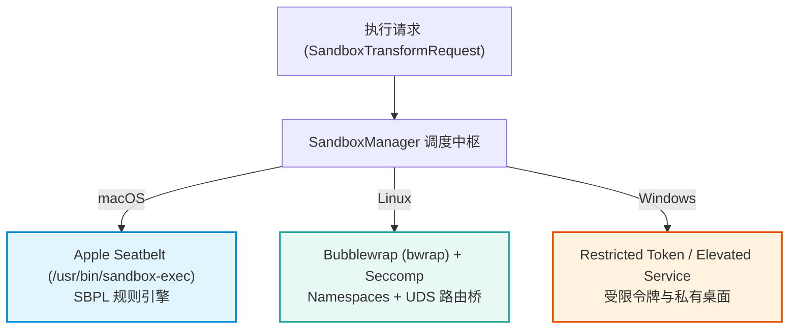
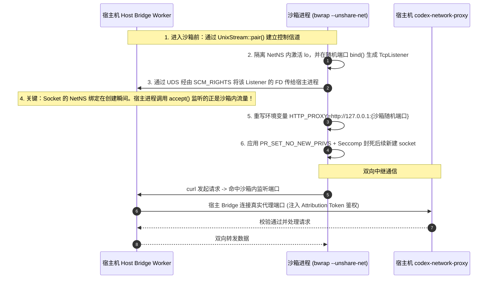
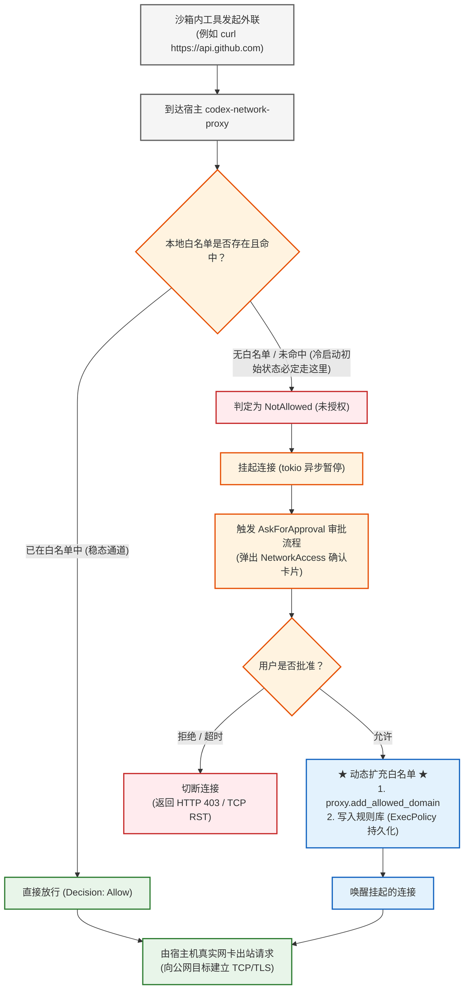
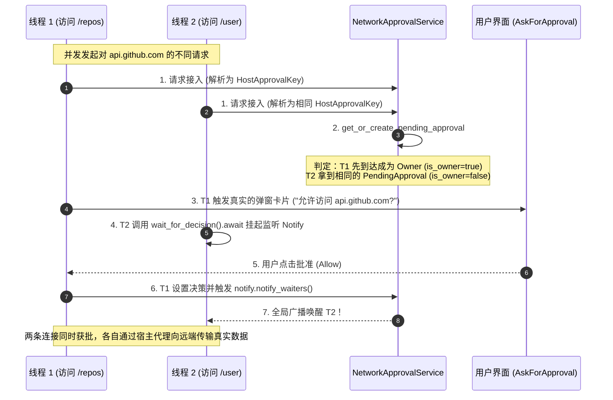

# OpenAI Codex 沙箱机制：配置模型、跨平台内核隔离与网络生命周期

> **核心公理**: $$\text{Harness} = \text{Agent} - \text{Model}$$
> 在 Agent Harness 工程中，沙箱（Sandboxing）是保护宿主环境不受失控或恶意代码破坏的底线物理防线。大模型仅负责生成意图与命令，所有的外部调用、文件操作与网络请求均被严格囚禁在操作系统内核级外壳内。

---

## 🗺️ 1. 沙箱配置模型与权限编译

Codex 提供了**粗粒度模式**与**细粒度权限配置文件（Permission Profiles）**两套配置机制，并严格遵循“默认封闭（Fail-Closed）”的零信任原则。

### 1.1 粗粒度模式：`SandboxMode`

在 `codex-rs/protocol/src/config_types.rs` 中定义了三种基础模式：

```rust
pub enum SandboxMode {
    #[default]
    ReadOnly,          // 全局只读，默认禁止出站网络
    WorkspaceWrite,    // 只读访问基础系统，允许写入工作区当前目录 (CWD)
    DangerFullAccess,  // 完全禁用沙箱，拥有宿主当前用户的完整权限
}
```

针对 `WorkspaceWrite`，可通过 `[sandbox_workspace_write]` 进行参数调整（如 `writable_roots` 额外白名单目录、`network_access` 是否放行外部网络、是否排除 `/tmp` 等）。

### 1.2 细粒度权限配置：`[permissions]` 体系

在 `config.toml` 中，Codex 支持通过声明式的 Profile 实现细粒度控制，支持单继承（`extends`）机制：

```toml
[permissions.secure-dev]
description = "Restricted dev profile"
extends = ":workspace"

[permissions.secure-dev.filesystem]
glob_scan_max_depth = 3

[permissions.secure-dev.filesystem.":workspace_roots"]
"**/*.env" = "deny"
"credentials.json" = "deny"
"build/**" = "write"

[permissions.secure-dev.network.domains]
"api.openai.com" = "allow"
"*.github.com"   = "allow"
```

### 1.3 零配置（Zero-Config）冷启动真相

很多人误以为 Codex 启动时本地一定预置了一份默认的 `config.toml` 并自带一份默认放行的域名清单。深入源码（`config/src/loader/mod.rs` 与 `network-proxy/src/config.rs`）可还原以下一手工程事实：

1. `**config.toml` 默认不存在**：
  - 首次安装和启动 Codex 时，`~/.codex/config.toml` 并不存在（测试断言 `assert!(!codex_home.path().join("config.toml").exists())`）。
  - 配置加载器捕获 `NotFound` 错误后**优雅降级为空表（Empty Table）**，系统平滑运行。
2. **没有任何预置的公网域名白名单**：
  - 内存默认模型中 `NetworkProxyConfig.domains = None`。
  - 当 `allowed_domains` 为空时，网络代理默认将所有出站网络判定为 `NotAllowed`，**100% 拦截并挂起**，绝不预设信任。

---

## 🛡️ 2. 跨平台操作系统沙箱引擎

Codex 在 `codex-rs/sandboxing` 中抽象了 `SandboxManager`，将抽象的执行需求转译为具体操作系统的内核调用机制。




### 2.1 macOS 引擎：Apple Seatbelt

- **系统调用加固**：使用绝对路径 `/usr/bin/sandbox-exec` 运行（防止 `PATH` 环境变量劫持）。
- **默认关闭**：加载 `seatbelt_base_policy.sbpl`，起点规则为 `(deny default)`。
- **网络限制（小孔原则）**：在 `seatbelt.rs` 动态生成的 SBPL 规则中，仅放行向宿主机 Loopback 代理端口的出站连接：
  ```lisp
  (allow network-outbound (remote ip "localhost:{port}"))
  ```
  沙箱内若试图向任何公网 IP 发起直连 TCP Socket，直接被 macOS 内核以 `EPERM` 拦截。

### 2.2 Linux 引擎：Bubblewrap + 跨命名空间中继网桥

在 Linux 上，无法照搬 macOS 的做法。

#### 为什么 Linux 不能直接连 `127.0.0.1` 代理端口？

- Linux 下 Codex 启用 **Network Namespace (`--unshare-net`)** 实现内核级网络隔离。
- 一旦进入独立的网络命名空间，沙箱内只有独立的虚拟 `lo` 网卡，**与宿主机的 `127.0.0.1` 在物理上互不相通**。

#### Codex 的跨命名空间中继黑科技（`proxy_routing.rs`）

为了让隔离 NetNS 内的进程连上宿主机的 `codex-network-proxy`，Codex 设计了一套基于 **文件描述符（FD）跨命名空间传递** 的 **TCP $\to$ UDS $\to$ TCP** 网桥：




---

## 🌐 3. 网络沙箱完整生命周期与白名单治理

网络沙箱的实际运行并非静态规则，而是一个由 **“初始阻断 $\to$ 人工审批 $\to$ 动态扩充 $\to$ 稳态放行”** 构成的两阶段演进闭环。

### 3.1 完整流程图

在真实系统中，流程区分**阶段 A（冷启动无白名单）与阶段 B（动态积累后的稳态）**：




---

### 3.2 白名单的配置语法与规则

域名白名单核心解析逻辑位于 `codex-rs/network-proxy/src/policy.rs`，支持严格的 Hostname 语法规范：

```toml
[permissions.workspace.network.domains]
"api.openai.com"    = "allow"   # 1. 精确匹配
"*.github.com"      = "allow"   # 2. 单星通配符 (Subdomains Only)
"**.huggingface.co" = "allow"   # 3. 双星通配符 (Apex + Subdomains)
"api?.example.com"  = "allow"   # 4. 单字符通配符
"127.0.0.1"         = "allow"   # 5. IP 字面量 (本地/私有 IP 需显式声明)
"evil.example"      = "deny"    # 6. 显式黑名单 (Deny)
```

1. **精确匹配（Exact）**：如 `"api.openai.com"`，只匹配该完整主机名，不匹配顶级域名 `openai.com` 也不匹配三级子域名。
2. **单星通配（`*.`）**：如 `"*.github.com"`，仅匹配严格子域名（如 `api.github.com`、`raw.github.com`），**明确排除**顶层域名 `github.com` 本身。
3. **双星通配（`**/*.`）**：如 `"**.huggingface.co"`，**同时匹配**顶层域名 `huggingface.co` 及其任意层级的所有子域名。
4. **单字符问号（`?`）**：如 `"api?.example.com"`，匹配单一字符（例如 `api1.example.com`）。
5. **IP 字面量与本地回环限制**：
  - 私有网络与回环地址（`127.0.0.1`、`localhost`、`10.x.x.x`）出于安全防护默认禁止，即使配置了通配符也无法放行；
  - 必须在配置中**显式书写精确的 IP 字面量或 `localhost`** 才能允许。
6. **Deny 优先原则**：
  - `Deny` 规则的优先级绝对高于 `Allow`。如果目标主机同时命中了允许规则与拒绝规则，一律判定为阻断。

---

### 3.3 动态白名单：会话内追加与持久化

白名单不是一成不变的死规则。当模型执行命令试图访问未经授权的新域名时，系统通过审批机制实现动态演进：

1. **挂起与弹窗确认**：
  代理层截获到不在白名单中的请求时，将连接挂起，向用户前端弹出 `ApprovalAction::NetworkAccess` 审批卡片（展示目标域名、端口及请求协议）。
2. **内存级即时放行（`proxy.add_allowed_domain`）**：
  用户点击允许后，核心层调用 `proxy.add_allowed_domain(&host)`：
  - 代理将新主机名插入运行时的 `allow_set` 并重新编译 `GlobSet`；
  - 正在挂起的 TCP/TLS 连接被唤醒，立即建立连接出站。
3. **规则库持久化（`ExecPolicy`）**：
  系统通过 `exec_policy.append_network_rule_and_update(...)` 将该审批放行决策持久化保存至工作区规则文件（`.codex/`）：
  - 该域名正式沉淀为该项目的长期合规白名单；
  - 后续同一域名再次访问时，直接命中白名单进入稳态免审批通道。

---

### 3.4 并发与锁治理：多线程访问相同域名不同内容的处理

在实际软件构建中，沙箱进程经常会并发向同一个域名发起对**不同资源路径（Path）**的网络请求（例如并发执行 `curl https://api.github.com/repos` 与 `curl https://api.github.com/user`，或者多线程构建下载依赖）。

Codex 在 `codex-rs/core/src/tools/network_approval.rs` 中设计了一套极其精妙的 **Singleflight 锁与去重机制**，避免并发连接导致审批弹窗风暴：




#### 关键锁与并发设计细节：

1. **域名粒度归一化（`HostApprovalKey`）**：
  审批与权限锁定的最小颗粒度是 **Host（协议 + 主机名 + 端口 + 环境 ID）**，**而不是具体的 URL 路径**。
   因此，无论沙箱内多线程访问同一域名下的什么不同资源路径，在核心调度层都被归一化为同一个审批键：
2. **会话缓存快速路径锁（`session_policy_commit_lock`）**：
  服务首先在轻量锁内检查 `session_approved_hosts`。如果之前该会话已经批准过该 Host，则无需进入审批流程，直接返回 `NetworkDecision::Allow` 放行。
3. **Leader / Follower 竞态去重（Singleflight）**：
  针对首次并发访问未授权域名，通过内部互斥锁管理 `pending_host_approvals`：
  - **Leader (Owner)**：第一个抢到锁的线程成为 `is_owner = true`，负责组装审批上下文向用户弹出唯一的审批卡片；
  - **Follower**：后到达的并发线程拿到同一个 `Arc<PendingHostApproval>`，直接进入异步等待。
4. **单次批准全局广播唤醒（`tokio::sync::Notify`）**：
  `PendingHostApproval` 内部基于 `SyncOnceLock` 与 `Notify` 构建：
   当用户在前端点击批准后，Owner 线程执行 `set_decision(decision)` 并调用 `self.notify.notify_waiters()`。所有挂起的 Follower 线程瞬间被全部唤醒，共享该放行决策，各自继续完成后续的网络通信。
   **核心价值**：即便并发打来数十个网络请求，用户也仅会收到一次审批卡片，体验平滑且无并发冲突。

---

## 🧭 4. 认知前沿地标（待探索内容）

沙箱体系不仅包含上述网络隔离维度，还与文件系统安全、进程生命周期以及提权控制深度交织。以下为后续学习与逆向探索的认知地标：

- [ ] **文件系统元数据硬阻断（防 Git Hook 提权）**：
  - 工作区虽然授予可写权限，但针对 `.git`、`.codex`、`.agents`、`.aws` 等敏感元数据，底层引擎是如何通过覆盖只读挂载（`--ro-bind`）或 SBPL 规则实施强制锁死的？如何防范模型通过在 `.git/hooks` 下写入恶意脚本实现特权逃逸？
- [ ] **SSRF / DNS 实时探针机制**：
  - 针对 DNS Rebinding 攻击（域名配置在白名单，但动态解析到内网 `192.168.x.x` 或 `127.0.0.1`），代理层的异步探测与拦截实现细节。
- [ ] **Credential Broker 凭据隔离机制**：
  - 沙箱中工具如何调用需要 GitHub / OpenAI Token 的接口，而环境变量中却无需暴露真实明文 Token？代理层如何通过 MITM 实时注入凭据？
- [ ] **编排器的两阶段提权（Two-Attempt Loop）**：
  - `core/src/tools/orchestrator.rs` 中命令执行失败捕获 `SandboxErr::Denied` 后，如何判定工具是否支持提权（`escalate_on_failure`），以及如何从受限沙箱平滑过渡到无沙箱重试。

---

## 🔗 体系联动

- [[openai_codex_architecture|OpenAI Codex 全景架构]]（了解沙箱层在 Codex 四层解耦架构中的物理防爆舱定位）
- [[openai_codex_cli|OpenAI Codex CLI 逆向]]（理解命令入口参数解析与影子进程 `codex-linux-sandbox` 的启动关系）
- [[harness_lifecycle|Harness 生命周期与解耦]]（理解通用执行外壳与项目安全策略的动态挂载）
- [[tool_explosion_and_governance|工具爆炸与治理]]（理解工具调用的最小特权原则与边界管控）

