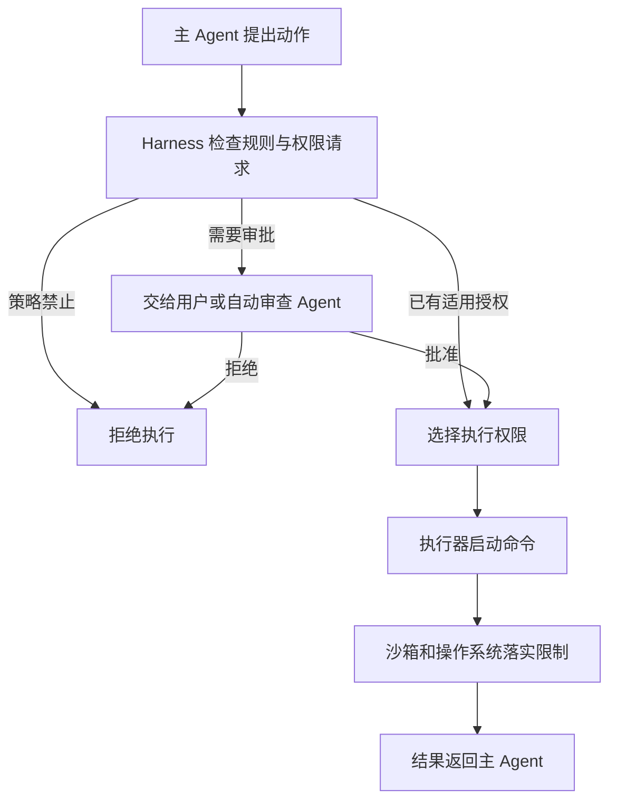

# Codex 沙箱提权与审批机制

> **核心理解**：主 Agent 提出动作和权限请求，Harness 检查规则并安排审批，用户或自动审查 Agent 作出决定，执行器与沙箱落实最终权限。
>
> **版本与范围**：依据 OpenAI Codex 源码提交 `89461ea6833832b0551ce24ee32205824d5c108d`（2026-10-19），核验日期为 2026-10-19。讨论本地命令工具及相关执行器路径；具体行为受审批策略、权限配置、工具实现与执行环境能力影响。本文示例为教学说明，未作为提权实测结果。

## 1 提权在解决什么问题

沙箱给命令划定一个可以自主工作的范围。例如，允许读写项目文件，但不允许写项目外的目录。权限够用时，Agent 可以持续工作；需要越过这个范围时，才涉及权限申请。

**这里的提权主要指扩大某次执行的访问范围，不会自动获得管理员身份，也不等于执行 `sudo`。**文件系统根目录 `/` 是路径范围，管理员 `root` 是用户身份，两者不能混淆。

可以把 Codex 想象成一个带门禁的工作室：

| 角色 | 通俗类比 | 实际职责 |
| --- | --- | --- |
| 主 Agent | 干活的人 | 理解任务、生成命令，需要时提出权限申请 |
| 编排器与 Harness | 管理员 | 检查命令规则、安排审批、选择执行权限、处理重试 |
| 用户或 Guardian 审查 Agent | 审批者 | 判断具体动作与权限请求是否可以批准 |
| 执行器与沙箱 | 执行人员与门禁 | 启动命令，落实文件系统、网络等限制 |

这体现了 [[openai_codex_architecture|Codex 全景架构]] 中模型、编排与物理执行的分工；底层隔离机制见 [[openai_codex_sandbox|Codex 沙箱机制]]。其中沙箱决定技术上能做什么，审批策略决定什么时候必须先取得批准。命令规则也可能要求审批，因此不能把所有审批都理解成已经发生了一次沙箱拒绝。[官方边界说明](https://learn.chatgpt.com/docs/sandboxing)

## 2 用生成索引的例子串起完整流程

用户要求：

> 帮我生成项目的检索索引。

假设项目位于 `/Users/me/project`，允许写入项目目录，但没有开放外部缓存目录。主 Agent 首先普通执行：

```bash
python scripts/build_index.py
```

脚本读取项目文档后，试图把索引写入 `/Users/me/.cache/myapp/index.json`，被沙箱阻止，返回类似 `Permission denied` 的结果。

主 Agent 收到失败结果后，可以考虑把缓存移入项目、申请指定目录的额外权限，或申请完整提权。它可能发出下面这个新工具调用：

```json
{
  "cmd": "python scripts/build_index.py",
  "sandbox_permissions": "require_escalated",
  "justification": "脚本需要写入工作区外的缓存目录，是否允许？"
}
```

这是简化的教学调用，尚未获得执行权限。Harness 先检查是否允许这类申请，再安排必要审批，批准后才选择对应的执行环境。

**`justification` 解释用途，不会自动变成目录访问规则。**理由写“只需要写缓存”，不代表 `require_escalated` 最终只开放该缓存目录。



如果模型事先就知道需要更大权限，也可以直接申请，不必先故意执行失败。程序语法错误、测试断言失败等问题则应分析程序本身，不能仅因命令失败就视为需要提权。

## 3 谁来审批以及 Guardian 是什么

### 3.1 审批时机与审批者分别配置

| 配置 | 回答的问题 | 示例含义 |
| --- | --- | --- |
| `approval_policy` | 何时允许或需要请求审批 | `on-request` 允许在需要时请求审批；`never` 不发起交互审批 |
| `approvals_reviewer` | 请求交给谁审查 | `user` 交给用户，`auto_review` 交给自动审查流程 |

常规默认审批者是 `user`。下面是两种配置示例，不代表所有客户端的最终生效配置：

```toml
# 人工审批
approval_policy = "on-request"
approvals_reviewer = "user"
```

```toml
# 自动审批
approval_policy = "on-request"
approvals_reviewer = "auto_review"
```

单独设置 `on-request` 不会自动启用 Guardian。客户端选择、模型关联行为和组织管理配置也可能影响实际模式；以会话中的生效配置为准。`never` 也不表示“遇到失败自动放开权限”。[默认审批者源码](https://github.com/openai/codex/blob/89461ea6833832b0551ce24ee32205824d5c108d/codex-rs/protocol/src/config_types.rs#L178)、[官方自动审批说明](https://learn.chatgpt.com/docs/sandboxing/auto-review)

### 3.2 配置值 机制与审查 Agent 的关系

```text
配置值 "auto_review"
    → 选择 Guardian 自动审查机制
    → 机制调用专门负责审查的 Agent
    → 返回审批决定与理由
```

`auto_review` 是配置值；Guardian 是源码中的自动审查机制；审查子 Agent 是其中进行模型判断的执行者。用户不需要创建一个名叫 `auto_review` 的 Agent。

Guardian 根据具体动作、请求的权限、相关对话证据和审查策略作判断。它可以在必要时进行只读检查，但通常不负责替主 Agent 设计扩权方案。**主 Agent 提申请，Guardian 审申请。**

人工模式下，用户批准后继续；自动模式下，Guardian 批准后通常直接继续，无需用户再签一次字。被拒绝时，主 Agent 应选择实质上更安全的方案，或向用户说明并请求进一步授权，不能把审批拒绝当成普通错误绕过。源码还支持 Hook 审批路径；不能把所有批准都归为 Guardian 决定。

## 4 获批后具体开放哪些权限

### 4.1 三种请求意图

| `sandbox_permissions` | 请求意图 |
| --- | --- |
| `use_default` | 使用当前默认沙箱策略 |
| `with_additional_permissions` | 保留沙箱，为本次命令请求额外权限；工具和配置须支持该流程 |
| `require_escalated` | 请求完整提权；实际采用取消沙箱还是保留禁令的扩权策略，由 Harness 按配置判断 |

若目标确实只是增加一个目录的写权限，需要用支持的结构化额外权限表达范围。完整提权请求不会仅根据申请理由自动收窄。[请求类型定义](https://github.com/openai/codex/blob/89461ea6833832b0551ce24ee32205824d5c108d/codex-rs/protocol/src/models.rs#L61)

### 4.2 允许脱离沙箱时

没有必须保留的显式禁止读取规则，且审批与其他执行条件允许时，显式提权可选择 `BypassSandboxFirstAttempt`：新的调用第一次执行就绕过沙箱。

它使用操作系统当前用户的权限。普通用户原本不能修改的系统文件，仍然可能被操作系统拒绝。完整绕过沙箱也不能与“只增加某个目录的权限”混为一谈。

### 4.3 存在禁止读取规则时

假设明确禁止访问 `/Users/me/project/secret.txt`。直接取消文件系统沙箱会丢失执行这条禁令的机制，因此新版提供：

```text
EscalatedSandboxWithRestrictions
    = 保留沙箱
    + 构造更广的文件系统权限
    + 保留显式禁止读取规则
```

进入这个分支需要显式提权请求和实际批准。仅有命令 `allow` 规则，不会在存在禁止读取规则时触发同样的扩权。若必要的本地沙箱不可用，或相关远程执行器不支持保留限制，执行会被拒绝。[策略选择与沙箱检查](https://github.com/openai/codex/blob/89461ea6833832b0551ce24ee32205824d5c108d/codex-rs/core/src/tools/sandboxing.rs#L234)、[执行器能力检查](https://github.com/openai/codex/blob/89461ea6833832b0551ce24ee32205824d5c108d/codex-rs/core/src/tools/orchestrator.rs#L264)

## 5 更广的文件系统权限是怎样构造的

### 5.1 重建允许访问的规则并保留显式禁令

核心函数 `for_approved_command(...)` 新建一套受限文件系统策略，以文件系统根的 `Write` 为起点，再复制原策略中的显式 `Deny`，解析工作区等符号路径，并检查限制能否安全落实。

这里的 `Write` 同时允许读取和写入。因此，**保留沙箱不等于保留原来的全部只读限制**。原来没有被显式禁止的位置，可能获得读写权限。

以下用 macOS 路径展示简化规则，省略元数据处理：

```text
原策略：
    /                                  → Read
    /Users/me/project                  → Write
    /Users/me/reference                → Read
    /Users/me/project/private          → Deny
    /Users/me/project/**/*.env          → Deny

获批后构造的核心规则：
    /                                  → Write
    /Users/me/project/private          → Deny
    /Users/me/project/**/*.env          → Deny
```

| 操作 | 原策略 | 获批重构后 |
| --- | --- | --- |
| 修改项目源码 | 允许 | 允许 |
| 写项目外的缓存 | 不允许 | 策略允许，仍须操作系统权限允许 |
| 修改参考资料目录 | 只读 | 策略允许，仍须操作系统权限允许 |
| 访问 `project/private` | 禁止 | 继续禁止 |
| 读取匹配的 `.env` 文件 | 禁止 | 继续禁止 |

这相当于“扩大作业区域，但封闭的房间继续封闭”。它不是把原策略全部保留后，再只增加一个缓存目录。原来禁止目录内的允许例外也不会原样搬入新策略，因此权限变化并非对每个路径都只增不减。

文件系统根依据执行环境的当前路径解析。Unix 示例中的 `/` 不能直接推广成 Windows 所有盘符；测试覆盖了其他卷的旧授权不会原样保留的情况。若禁令覆盖根本身或无法安全解析，构造函数保留原策略，不强行扩大权限。[策略构造](https://github.com/openai/codex/blob/89461ea6833832b0551ce24ee32205824d5c108d/codex-rs/protocol/src/permissions/target.rs#L45)、[访问模式定义](https://github.com/openai/codex/blob/89461ea6833832b0551ce24ee32205824d5c108d/codex-rs/protocol/src/permissions.rs#L120)、[对应测试](https://github.com/openai/codex/blob/89461ea6833832b0551ce24ee32205824d5c108d/codex-rs/protocol/src/permissions/target_approved_materialization_tests.rs#L40)

### 5.2 元数据保护与网络策略

普通工作区模式附带的 `.git`、`.agents`、`.codex`、`.aws` 元数据写保护，与显式 `Deny` 不同。获批策略会处理默认元数据保护，以支持更新 Git 元数据等操作；测试明确检查工作区 `.git/FETCH_HEAD` 可写。若对相关路径另有显式禁令，禁令继续保留。

在 `EscalatedSandboxWithRestrictions` 分支中，新权限配置沿用原网络策略和执行约束方式。**扩大文件系统访问范围不自动意味着允许任意联网。**完整绕过沙箱则属于不同分支，不能套用同样的网络保留结论。[新权限配置构造](https://github.com/openai/codex/blob/89461ea6833832b0551ce24ee32205824d5c108d/codex-rs/core/src/tools/orchestrator.rs#L236)

## 6 两次尝试与模型重新申请的区别

界面上看到“失败后申请权限，再执行一次”，内部可能是两条不同路径。

### 6.1 路径 A 编排器内部的 Two-Attempt Loop

**路径 A 是：主模型发出一次工具调用，第一次被沙箱拒绝后，Harness 在这次调用内部处理审批并安排重试。中间不需要主模型重新生成工具调用。**

用户的请求仍然先交给模型，由模型判断是否调用工具。只有命令开始执行后，才会进入下面的失败处理流程：

```text
用户提出任务
    → 主模型生成工具调用
    → Harness 检查规则与必要的首次审批
    → 第一次按选定沙箱执行
    → 执行层报告沙箱拒绝
    → Harness 检查内部重试条件
    → 取得重试所需批准或复用适用批准
    → Harness 重新执行同一个工具请求
    → 结果返回主模型
```

**什么时候允许走 A？**需要连续通过以下检查：

1. 错误被归类为 `SandboxErr::Denied`；测试断言失败等普通错误不满足这个条件。
2. 工具的 `escalate_on_failure()` 支持内部提权重试。
3. 工具与审批策略允许在失败后申请这种重试。例如，普通命令工具使用 `granular` 策略且 `sandbox_approval = true` 时，可以通过这道检查；并不代表其他检查或审批自动通过。
4. 当前权限限制允许相应执行方式。存在禁止读取规则时，普通文件系统拒绝不能直接通过这条路径取消沙箱；涉及受管网络拒绝时，还要满足网络审批分支的条件。

这里的“判断”主要是 Harness 按已有程序分支检查条件，不是让主模型重新规划“应该开放哪个目录”。用户或 Guardian 负责批准动作，不能与 Harness 的分支检查混为一谈。

**例子 A：管理员接住失败，在内部办手续后再试一次。**

沿用第 2 节的索引任务：主模型调用 `python scripts/build_index.py`，脚本需要写 `/Users/me/.cache/myapp/index.json`，但原沙箱没有这个目录的写权限。

为展示路径 A，假设使用支持内部重试的普通命令工具，`granular` 策略开启沙箱审批，审批者为 Guardian，没有禁止读取规则，也没有其他阻止执行的规则。首次受限执行所需的审批已经通过。这些是教学前提，不是普通 `on-request` 模式的默认行为。

```text
主模型：调用 build_index.py
    ↓
Harness：第一次在受限沙箱中执行
    ↓
沙箱：写外部缓存被拒绝，工具返回沙箱拒绝
    ↓
Harness：工具支持重试，策略也允许申请
    ↓
Harness：将沙箱外重试的实际权限提交 Guardian 审查
    ↓
Guardian：批准本次重试（示例假设）
    ↓
Harness：重新运行同一个脚本，写入缓存成功（示例假设）
    ↓
主模型：收到最终执行结果
```

主模型在这个例子里只生成了一次工具调用。第一次受限执行的 Guardian 批准不能直接替代更大权限的重试审批，具体范围见第 7 节。

这条编排器路径最多安排一次重试。第二次仍失败就返回结果，不会在这里无限扩权；也不会因第一次失败，就自动转入第 4.3 节的“保留禁令并广泛扩权”。后者在显式获批请求的首次执行选择中实现。

### 6.2 路径 B 模型提出新的权限请求

**路径 B 是：第一次工具调用已经结束，Harness 把失败返回主模型，主模型分析原因后，再提出一份新的权限请求。**

```text
用户提出任务
    → 主模型生成普通工具调用
    → Harness 检查后执行
    → 执行被沙箱拒绝
    → Harness 不安排内部提权重试，返回失败
    → 主模型读取报错并判断下一步
    → 若决定申请更多权限，生成新的工具调用
    → Harness 检查请求并安排必要审批
    → 获批后，新调用第一次执行就使用相应权限策略
```

**什么时候先返回模型？**最常见的是“普通命令工具 + `on-request` + 普通文件系统沙箱拒绝”。当前版本普通命令工具的默认 `wants_no_sandbox_approval(OnRequest)` 为 `false`，因此这个配置下不会直接在内部申请无沙箱重试。工具不支持内部重试，或当前权限限制不允许相应重试时，也会返回失败。

返回模型并不等于一定走 B。模型还可以改用项目内的缓存目录、修改命令或停止；只有模型随后提出新的权限请求，才构成这里讨论的路径 B。若审批策略禁止提权申请，模型也不能因失败就继续申请。

**例子 B：管理员退回失败工单，主模型分析后重新申请。**

仍然执行同一个索引脚本，这次换成普通命令工具的 `on-request` 配置，由用户审批。假设没有特定网络审批例外，没有禁止读取规则，也没有其他阻止执行的规则。

```text
主模型：用默认权限调用 build_index.py
    ↓
Harness：在受限沙箱中执行
    ↓
沙箱：写外部缓存被拒绝
    ↓
Harness：当前配置不走内部提权重试，将失败返回主模型
    ↓
主模型：根据报错，判断脚本需要写项目外的缓存
    ↓
主模型：生成第二个调用，显式申请 require_escalated 并说明理由
    ↓
Harness：检查申请，向用户请求批准
    ↓
用户：批准
    ↓
Harness：按获批权限执行新的调用
    ↓
主模型：收到执行结果
```

第二个调用可采用第 2 节的 JSON 示例。主模型在这里生成了两次工具调用；第二次执行并非“第一次失败进程继续运行”，而是新请求下的重新执行。

**用同一个任务区分分流条件：**

| 工具与配置 | 第一次沙箱拒绝后的典型处理 |
| --- | --- |
| 普通命令工具，`granular` 开启 `sandbox_approval` | 满足其余条件并获批，可在内部走 A |
| 普通命令工具，`on-request`，普通文件系统拒绝 | 先返回主模型；主模型重新提出权限请求时走 B |
| `apply_patch`，`on-request` | 工具覆盖了默认值，满足其余条件并获批可走 A |
| `on-request` 下特定受管网络审批场景 | 存在可继续内部审批重试的例外分支 |
| `never` | 不通过这套流程发起提权审批，失败后在限制内处理 |

**A/B 由工具、策略、错误类型与权限限制共同决定，不由用户的问题类型或 Guardian 单独决定。**两条路径都通常先经过主模型生成工具调用。

如果已有权限足够，例如在允许读取的项目内执行 `rg -n TODO src`，且命令规则允许，就可以检查后直接执行，无需先失败，也不涉及 A/B。主模型事先知道权限不足时，也可以先申请再执行，无需故意撞一次沙箱。

[默认策略](https://github.com/openai/codex/blob/89461ea6833832b0551ce24ee32205824d5c108d/codex-rs/core/src/tools/sandboxing.rs#L344)、[编排器拒绝与重试分支](https://github.com/openai/codex/blob/89461ea6833832b0551ce24ee32205824d5c108d/codex-rs/core/src/tools/orchestrator.rs#L394)、[补丁工具覆盖](https://github.com/openai/codex/blob/89461ea6833832b0551ce24ee32205824d5c108d/codex-rs/core/src/tools/runtimes/apply_patch.rs#L136)

## 7 批准范围与执行结果

**批准受限执行，不自动等于批准更大权限执行。**新版记录批准来自用户、Hook 还是 Guardian；Guardian 对第一次受限执行的批准，不能直接预先批准权限更大的内部重试。可脱离沙箱的命令重试送审时，会把审批动作标记为 `RequireEscalated` 并清除较窄的 `additional_permissions`，让审查和缓存对应实际重试权限。用户与 Hook 的批准仍按既有条件判断是否可复用。[重试审批范围](https://github.com/openai/codex/blob/89461ea6833832b0551ce24ee32205824d5c108d/codex-rs/core/src/tools/orchestrator.rs#L484)

提权也不能保证成功。磁盘满、程序错误、操作系统权限不足，都可能让获批后的执行继续失败。重跑命令通常意味着从头再执行，第一次已经产生的修改不保证自动回滚。

这套实现为当前工具执行构造权限对象，不会在这里把全局配置改成 `danger-full-access`。审批能否复用、是否授予会话权限，与进程实际使用的权限是不同问题。如果启动了持续运行的终端，工具返回部分输出不意味着终端权限已经恢复；源码会记录文件系统扩权状态，供启用 stdin 审批时检查后续输入。[终端扩权记录](https://github.com/openai/codex/blob/89461ea6833832b0551ce24ee32205824d5c108d/codex-rs/core/src/tools/runtimes/unified_exec.rs#L647)

## 8 Guardian 的源码阅读入口

| 想理解什么 | 固定版本源码 |
| --- | --- |
| 审查 Agent 的工作要求 | [policy_template.md](https://github.com/openai/codex/blob/89461ea6833832b0551ce24ee32205824d5c108d/codex-rs/prompts/templates/guardian/policy_template.md) |
| 默认批准与拒绝规则 | [policy.md](https://github.com/openai/codex/blob/89461ea6833832b0551ce24ee32205824d5c108d/codex-rs/prompts/templates/guardian/policy.md) |
| 模型与最终基础指令的组装 | [reviewer_config.rs](https://github.com/openai/codex/blob/89461ea6833832b0551ce24ee32205824d5c108d/codex-rs/core/src/guardian/reviewer_config.rs#L18) |
| 对话证据与具体动作的组织 | [prompt.rs](https://github.com/openai/codex/blob/89461ea6833832b0551ce24ee32205824d5c108d/codex-rs/core/src/guardian/prompt.rs#L88) |
| 审查会话的运行 | [review_session_setup.rs](https://github.com/openai/codex/blob/89461ea6833832b0551ce24ee32205824d5c108d/codex-rs/core/src/guardian/review_session_setup.rs#L363) |

默认模板不等于每次运行的最终提示词；模型、用户与组织配置可能影响生效策略。官方说明自动审查记录默认保存在 `~/.codex/sessions`，实际记录取决于是否触发过审查及持久化配置。[官方记录说明](https://learn.chatgpt.com/docs/sandboxing/auto-review#reduce-review-volume-without-weakening-security)

## 附注 granular 审批策略

`granular` 意为“细粒度”，可以理解为一排按类别设置的审批开关。它控制哪些请求可以进入审批流程，不直接开放目录权限，也不指定由谁审批。

| 开关 | 控制的审批类别 |
| --- | --- |
| `sandbox_approval` | 沙箱相关的命令权限申请 |
| `rules` | 命令执行规则触发的审批 |
| `request_permissions` | `request_permissions` 工具的权限申请 |
| `mcp_elicitations` | MCP 发起的交互请求 |
| `skill_approval` | 技能脚本执行的审批 |

例如，下面的配置允许沙箱相关申请和命令规则触发的审批交给用户，其余列出的请求类别不开放：

```toml
approvals_reviewer = "user"

[approval_policy.granular]
sandbox_approval = true
rules = true
request_permissions = false
mcp_elicitations = false
skill_approval = false
```

**`true` 表示允许申请，不是自动批准；`false` 表示拒绝该类别的请求，不是免审批执行。**审批者仍由 `approvals_reviewer` 等生效配置决定，实际访问范围仍由权限策略与执行环境决定。

与路径 A 的关系是：普通命令工具被沙箱拒绝后，`granular.sandbox_approval = true` 可以允许它继续申请内部重试所需的批准；仍需满足工具能力、权限限制等条件，获批后才执行重试。

依据本文固定版本的 [GranularApprovalConfig 定义](https://github.com/openai/codex/blob/89461ea6833832b0551ce24ee32205824d5c108d/codex-rs/protocol/src/protocol.rs#L1123) 与 [内部重试审批策略](https://github.com/openai/codex/blob/89461ea6833832b0551ce24ee32205824d5c108d/codex-rs/core/src/tools/sandboxing.rs#L344)。

## 🔗 体系联动

- [[openai_codex_sandbox|Codex 沙箱机制]]：权限配置、底层隔离、元数据保护与网络生命周期；本文补充审批和获批执行路径。
- [[openai_codex_architecture|Codex 全景架构]]：将主 Agent、编排器、审查 Agent 和执行器放回完整 Harness 中理解。
