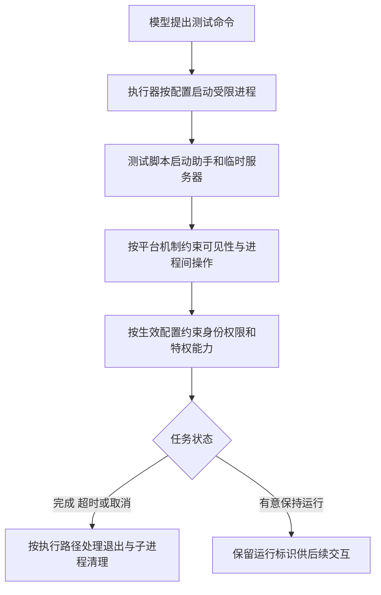

# Codex 进程隔离与权限边界

> 沙箱不仅要管“进程能访问哪些文件”，还要管“它能看到谁、干涉谁、能否变成更有权力的身份，以及结束时如何清场”。
>
> 本文依据 Codex 提交 `89461ea6833832b0551ce24ee32205824d5c108d`，核验日期为 2026-10-19。以 Linux 源码为主，对照 macOS；示例用于解释机制，不代表已完成跨平台运行实验。

本文是 [[openai_codex_sandbox|Codex 沙箱机制]] 的进程专题，用运行测试的例子解释进程视野、身份权限和子进程清理。

## 1 进程就是正在运行的程序

用户让 Codex 运行测试，主模型生成命令：

```bash
python run_tests.py
```

磁盘上的 `run_tests.py` 是程序文件；运行时，操作系统为执行它的程序分配内存、身份和编号，这个正在运行的实例就是**进程**。测试脚本还可能请来几个“帮手”：

```text
测试脚本
├── 测试助手 A
├── 测试助手 B
└── 临时测试服务器
```

启动别人的叫**父进程**，被启动的叫**子进程**，把“谁启动了谁”画出来就是**进程树**。沙箱需要考虑整个执行链，不能只约束最开始的脚本。

## 2 能看到谁与能干涉谁是两件事

电脑上可能同时运行浏览器、编辑器、数据库和测试程序。测试程序通常只需要完成测试，不需要随便查看或影响其他程序。

| 概念 | 大白话 |
| --- | --- |
| PID | 操作系统给进程分配的编号 |
| PID namespace | 为一组进程建立自己的编号和可见范围，可以理解为“独立的进程通讯录” |
| 信号 signal | 发给进程的通知，例如“请退出”或“立刻停止” |
| 调试 ptrace | 检查、暂停或控制另一个进程，调试器可能需要这种能力 |
| 跨进程内存访问 | 一个程序读取或修改另一个程序的内存 |

在使用独立 PID 命名空间并正确挂载对应进程信息目录的 Linux 路径中，可以这样理解两个视野：

```text
宿主机看到：浏览器、编辑器、数据库、测试任务……
测试任务内部看到：测试脚本、测试助手、临时服务器……
```

它们仍在同一台电脑上使用同一个内核。内核是操作系统中实际管理资源、执行权限检查的部分；建立命名空间不会为每个任务创建一个新内核。

Codex 的 Linux 参数中有建立新 PID 命名空间的路径，也支持继承原来的 PID 命名空间，因此不能把独立视野视为所有执行配置的统一保证。Linux 中外层管理进程仍可以看到内层进程，内层不能通过自己的 PID 视野看到外层进程。

**知道浏览器在运行，不等于能读取浏览器的内存。**可见性之外，还需要单独检查信号、调试和内存访问等操作权限。

一手依据：[Codex 的命名空间与进程信息目录参数](https://github.com/openai/codex/blob/89461ea6833832b0551ce24ee32205824d5c108d/codex-rs/linux-sandbox/src/bwrap.rs#L356)、[Linux PID 命名空间说明](https://man7.org/linux/man-pages/man7/pid_namespaces.7.html)。

## 3 系统调用与 seccomp 就是请求和检查清单

程序执行很多操作时，要请求内核帮忙，例如：

```text
请打开这个文件。
请连接这个服务器。
请读取另一个进程的内存。
```

这种向内核提出的请求叫**系统调用**。**seccomp 是 Linux 的系统调用过滤机制**，可以理解为请求入口的检查员，按照清单允许或拒绝操作。

例如，某套清单可以拒绝调试其他进程、读取其他进程内存或建立特定网络连接。检查的是底层实际操作，不只是命令文字；脚本调用的库发出受限系统调用时，也会受到检查。

这里说的 **“seccomp 模式”指 Codex 内部选择的几套过滤配置**，就像同一个检查员拿到不同的检查清单：

| Codex 内部配置 | 通俗理解 |
| --- | --- |
| `Restricted` | 限制直接联网的过滤配置 |
| `ProxyRouted` | 配合受管代理联网使用的过滤配置；代理是中间转发网络请求的服务 |
| `VmSocketRestricted` | 保留普通网络访问，但限制某些通往宿主服务的特殊通道 |

这些是 Codex 的配置分支，不是“只要启用 seccomp 就必然具备”的统一防护。

当前源码在前两种配置中禁止 `ptrace`、`process_vm_readv`、`process_vm_writev`，分别涉及调试、跨进程内存读和写；第三种配置没有使用同样的这组三项规则。不能只看到 seccomp 这个名字，就认定所有相关操作都已被禁止。

一手依据：[过滤配置选择与系统调用清单](https://github.com/openai/codex/blob/89461ea6833832b0551ce24ee32205824d5c108d/codex-rs/linux-sandbox/src/seccomp.rs#L101)。

## 4 防止进程自行获得更大身份权限

先区分两种“提权”：

| 场景 | 谁在做什么 |
| --- | --- |
| Harness 安排权限升级 | 主 Agent 提出申请，获批后，Harness 按不同权限安排执行，详见 [[openai_codex_sandbox_escalation|沙箱提权与审批机制]] |
| 进程试图提升身份权限 | 已经运行的程序试图通过系统机制获得更大身份或特权能力 |

Linux 的某些可执行文件带有 **setuid** 标记。可以粗略理解为：满足条件时，运行这个文件，程序可以取得文件所有者的有效身份。`sudo` 的常见实现利用这类机制，再进行自己的授权检查；不能认为“最初是普通用户启动，之后就一定不会取得更大权限”。

Linux 为此提供 **`no_new_privs`** 标记，可以读成：**执行其他程序时，不获得新特权。**

```text
带有 no_new_privs 标记的测试脚本
    → 启动带 setuid 标记的程序
    → 内核不因该文件标记授予新的身份权限
```

该标记不能清除，会被后续子进程继承；通过执行文件取得的相关文件能力也受到约束。但它不自动拿走进程已经拥有的全部权限，也不阻止所有不经过执行新程序的权限变化。

**capabilities** 则是 Linux 拆分出来的特权能力，可以理解为一串不同用途的钥匙，例如进行某些网络或系统管理操作的能力：

```text
移除 capabilities：拿走不该带进作业区的特权钥匙。
设置 no_new_privs：防止通过执行另一个程序，再取得新特权。
```

Codex 相关 Linux 沙箱路径使用 `--cap-drop ALL` 移除能力，并在内部执行阶段检查 effective、permitted 集合是否为空。两者分别表示当前可使用、以及被允许使用的特权能力；检测到残留时拒绝继续。

`no_new_privs` 的设置有条件，例如需要对应 seccomp 过滤时；不能推广到所有无沙箱执行。某些 `bwrap` 安装本身依赖 setuid 建立隔离环境，因此 Codex 先建立隔离，再在内部应用适用的限制，最后运行用户命令。可信的沙箱初始化阶段与受限任务执行阶段需要区分。

一手依据：[Linux 内核对 no_new_privs 的定义与限制](https://docs.kernel.org/userspace-api/no_new_privs.html)、[Codex 的设置条件](https://github.com/openai/codex/blob/89461ea6833832b0551ce24ee32205824d5c108d/codex-rs/linux-sandbox/src/seccomp.rs#L68)、[能力移除参数](https://github.com/openai/codex/blob/89461ea6833832b0551ce24ee32205824d5c108d/codex-rs/linux-sandbox/src/bwrap.rs#L381)、[内部能力检查](https://github.com/openai/codex/blob/89461ea6833832b0551ce24ee32205824d5c108d/codex-rs/linux-sandbox/src/linux_run_main.rs#L172)、[沙箱建立顺序](https://github.com/openai/codex/blob/89461ea6833832b0551ce24ee32205824d5c108d/codex-rs/linux-sandbox/src/linux_run_main.rs#L88)。

## 5 结束时如何清场

测试脚本卡住，用户点停止。如果只结束最开始的脚本，不能认定测试助手和临时服务器都已经结束。

Codex 的 Unix 进程管理使用**进程组**：给一批进程编个组号，方便批量发通知。

```text
测试任务进程组
    测试脚本
    测试助手 A
    测试助手 B
    ……
```

| 信号 | 大白话 |
| --- | --- |
| `SIGTERM` | 请退出，程序有机会进行清理 |
| `SIGKILL` | 强制终止，程序不能捕获它来拒绝退出 |

`core/src/exec.rs` 的相关路径在取消时先发送 `SIGTERM`，再根据情况强制清理原进程组；超时和 PTY 终止也有相应处理。**PTY 是让程序像在终端里一样交互的设施**，例如用于交互式 shell。

**进程树是亲属关系，进程组是分组关系。**子进程可以新建会话、改变分组，所以向原进程组发信号，不能单独证明所有后代都被回收。

Linux 中还有两类配合机制：

- **父进程退出通知**：相关启动路径设置 `PR_SET_PDEATHSIG`，让子进程在指定父进程退出时收到信号；`bwrap` 参数中也有 `--die-with-parent`。
- **PID 命名空间生命周期**：其中第一个进程的编号是 PID 1。它退出时，Linux 内核会终止该命名空间的剩余进程。可以理解为关闭整个任务作业区，而不是只通知某一个分组的人离开。

后一种效果以确实建立对应命名空间、相关进程仍在其范围内为前提。各清理机制覆盖的对象不同，不能概括成所有平台、配置和后台进程都一定全量回收。

一手依据：[超时与取消处理](https://github.com/openai/codex/blob/89461ea6833832b0551ce24ee32205824d5c108d/codex-rs/core/src/exec.rs#L1027)、[PTY 进程组终止](https://github.com/openai/codex/blob/89461ea6833832b0551ce24ee32205824d5c108d/codex-rs/utils/pty/src/pty.rs#L93)、[进程组与父进程退出信号](https://github.com/openai/codex/blob/89461ea6833832b0551ce24ee32205824d5c108d/codex-rs/utils/pty/src/process_group.rs)、[Linux PID 1 的生命周期规则](https://man7.org/linux/man-pages/man7/pid_namespaces.7.html)、[新建会话的作用](https://man7.org/linux/man-pages/man2/setsid.2.html)。

## 6 macOS 用不同机制约束进程

macOS 的 **Seatbelt** 可以理解为由内核执行的一份进程行为限制清单；**SBPL** 是描述这份清单的策略语言。

Codex 的基础策略包含：

```scheme
(deny default)
(allow process-exec)
(allow process-fork)
(allow signal (target same-sandbox))
(allow process-info* (target same-sandbox))
```

通俗理解：默认拒绝未放行的行为，允许启动和执行子进程，子进程继承沙箱约束；对信号和进程信息操作，基础策略按“同一沙箱”限定范围。

这与 Linux 的 PID 命名空间或 `no_new_privs` 是不同机制，不能直接套用相同保证。macOS 下 sudo/setuid 的具体表现，以及不同进程操作的完整边界，仍需结合实际平台继续验证。

一手依据：[macOS 基础策略](https://github.com/openai/codex/blob/89461ea6833832b0551ce24ee32205824d5c108d/codex-rs/sandboxing/src/seatbelt_base_policy.sbpl#L7)。

## 7 把一次测试的过程连起来



**工具返回不等于进程结束。**例如开发服务器可以有意保持运行，Codex 返回可继续交互的运行标识。需要区分正常保留的长时间任务，与应该结束却未被正确管理的后台进程；也不能把工具的等待输出时间，直接当作进程的终止期限。

Linux 侧各机制可以分别记成：命名空间划定视野，能力移除拿走特权钥匙，`no_new_privs` 约束通过执行程序获得新特权，seccomp 按清单过滤系统调用，生命周期管理负责按范围清场。

## 🔗 体系联动

- [[openai_codex_sandbox|Codex 沙箱机制]]：沙箱总览、平台隔离与网络生命周期。
- [[openai_codex_sandbox_escalation|Codex 沙箱提权与审批机制]]：区分 Harness 获批扩权与进程自行提升身份权限。
